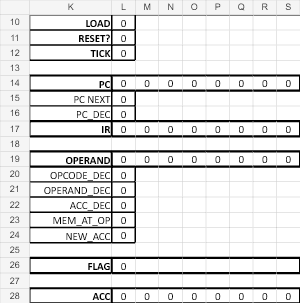
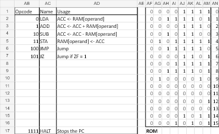

# Excel 8-bit CPU

**A tiny programmable computer built inside an Excel workbook.** Write a short program, advance its clock, and watch the memory and registers change in spreadsheet cells.

I wanted to learn how a CPU works. Building one in Excel seemed like an entertaining way to find out.

| Inside the CPU | Instructions and program memory |
| :---: | :---: |
|  |  |

*Previews of the actual saved workbook, before running a program. Click either image to enlarge it. The VBA buttons are outside these views.*

**[Download the workbook](https://github.com/VytenisNarmontas/excel-8bit-cpu/raw/refs/heads/main/8bit_pc.xlsm)** · **[Setup and programming guide](docs/USAGE.md)**

---

## What is it?

A CPU carries out a program by reading instructions, doing calculations, storing results, and deciding which instruction comes next. This workbook models a small version of that process where you can see the pieces directly.

Here, **8-bit** means each value is stored as eight binary digits: a number from **0 to 255**. The machine has just **16 bytes of RAM**, so the program and its data have to share a very small space.

The cells represent:

- **Memory:** the instructions and numbers the program uses.
- **A program counter:** the address of the current instruction.
- **An instruction register:** the instruction being carried out.
- **An accumulator:** the working value used for calculations.
- **A zero flag:** a signal that lets a program make a decision when a calculation reaches zero.

The formulas do the CPU work. Small VBA controls advance the clock, reset the machine, and load a program. The workbook models these parts with spreadsheet logic and arithmetic; it does not simulate individual transistors or logic gates.

## Where the idea came from

I had seen people build computers with Minecraft redstone and wanted to understand how something like that worked. I had also found a few discussions about doing it in Excel, so I decided to try building my own.

The appeal was being able to look at the whole machine. Instead of hiding everything behind a program window, the memory, registers, and control signals are right there in the cells.

## Three attempts to make it work

I started in **2024** and spent **roughly two to three months** across three versions. This preserved version took **about three weeks**.

1. **First version:** I used a lot of VBA for calculations and decisions. It helped me check my understanding of how a simple computer should behave.
2. **Second version:** I moved more of the work into formulas, but ran into problems with the clock, cells retaining their values, and the timing of recalculation. I ended up moving parts of the machine around the sheet to try to get the updates to happen in the right order.
3. **Third version:** I rebuilt it with cleaner timing and a way to load a program without overwriting the memory formulas. This is the version in the repository; the first two are no longer available.

AI helped with some cell formulas and wrote the VBA controls. I checked the formulas and code before using them, then tested programs in the workbook.

## What works

The included example calculates **11 × 21 = 231** by repeated addition and stores the answer at **RAM address 13**. I tested that example and other short programs that fit in the available memory.

The instruction set can load, add, subtract, store, jump, branch when the result is zero, and halt. You can step through the clock phases to watch the state change, or use **RUN** for a program with a suitable stopping condition.

The workbook is still a small learning experiment. Its main constraints are:

- **Tiny memory:** instructions and data share 16 bytes of RAM.
- **8-bit arithmetic:** values wrap around at 256.
- **Excel-specific setup:** it needs desktop Excel, VBA macros, and particular iterative-calculation settings.
- **A reset quirk:** RESET sometimes needs several presses to clear the state, including the zero flag.
- **A simple Run control:** RUN stops on HALT or when the program counter reaches address 15. It cannot detect every endless loop.

## Try it

1. Download `8bit_pc.xlsm` and open it in **desktop Microsoft Excel** with VBA support.
2. Enable the workbook's macros and switch to the **MAIN** sheet.
3. Enable iterative calculation with **Maximum Iterations = 1** and **Maximum Change = 100**.
4. Press **RESET** a few times, then **LOAD**.
5. Use **STEP** to advance one clock phase, or **RUN** for the included example. Look for **231 at RAM address 13** in the decimal-value column.

The [usage guide](docs/USAGE.md) explains the controls, cell locations, example program, and how to write your own. Work on a copy if you want to experiment. Excel for the web cannot run the VBA controls; see [Microsoft's VBA guidance](https://support.microsoft.com/en-au/excel/work-with-vba-macros-in-excel-for-the-web).

## Possible next steps

A short recording of a program running and a few more documented example programs would make it easier to explore. These are ideas for future additions.

---

Created by **Vytenis Narmontas** as a hobby project to learn about CPUs. Built with help from AI, with the formulas and VBA checked before use.

**License:** [MIT](LICENSE). Microsoft Excel is required separately.
